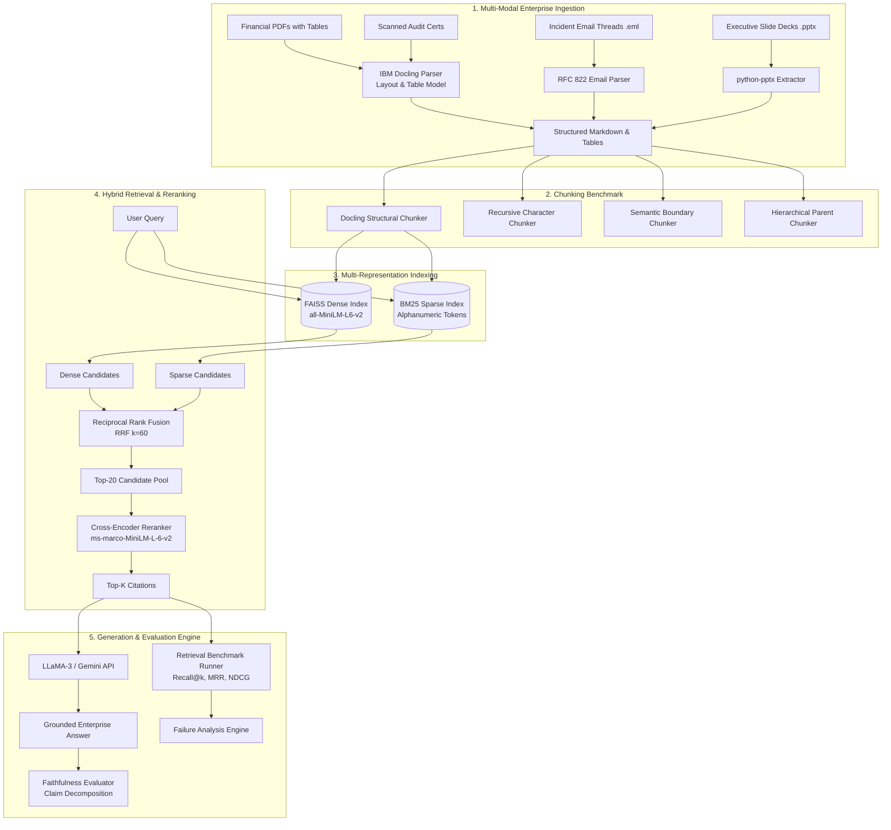

# 🔬 DoclingBench: Enterprise RAG Retrieval Benchmark

An empirical engineering benchmark and evaluation platform that compares ingestion parsers, chunking strategies, dense embedding models, BM25 keyword search, reciprocal rank fusion (RRF), and cross-encoder reranking on messy unstructured enterprise documents (multi-column PDFs with complex tables, incident email threads, SLA contracts, and executive presentation decks).

Powered by **IBM Docling**, **FAISS**, **BM25Okapi (`rank_bm25`)**, **SentenceTransformers**, **Cross-Encoder Rerankers**, **LangChain**, and **LLaMA-3 / Gemini**.

---

## 🌟 Core Pillars & Capabilities

### 1. Unstructured Enterprise Document Ingestion (IBM Docling & Email Parsers)
- **IBM Docling Integration**: Deep layout analysis and table structure recognition converting messy PDF financial reports and scanned tables into structured Markdown tables (`| Col1 | Col2 | ... |`) preserving spatial hierarchies and cell alignment.
- **Enterprise Email Ingestion (`.eml`, `.msg`)**: Preserves RFC 822 / Outlook email thread structures, recipient headers (`From`, `To`, `Cc`, `Date`), action item tables, and incident timelines.
- **Multi-Modal Support**: Dispatches across PDFs, slide decks (`.pptx`), emails (`.eml`), Word documents (`.docx`), and Markdown.

### 2. Multi-Strategy Chunking Benchmark
Empirically compare 4 distinct chunking paradigms:
1. **Docling Structural Chunking**: Preserves Markdown tables and bullet hierarchies intact without slicing rows or columns; injects document breadcrumbs (`[Document | Section]`).
2. **Recursive Character Chunking (Baseline)**: Fixed-size sliding window (600 chars, 100 overlap). Demonstrates classic failure modes when cutting through tables and paragraphs.
3. **Semantic Boundary Chunking**: Splits text along proposition and sentence boundaries.
4. **Hierarchical Parent-Child Chunking**: Indexes small leaf chunks (250 chars) for search accuracy while mapping back to parent context (1200 chars) for LLM synthesis.

### 3. Multi-Model Hybrid Retrieval & Reranking Engine
- **Dense Vector Search**: Powered by FAISS and SentenceTransformers (`all-MiniLM-L6-v2`, `BAAI/bge-small-en-v1.5`).
- **Sparse Lexical Search**: BM25Okapi (`rank_bm25`) with specialized alphanumeric tokenization for project codes, ticket IDs (`INC-7721-P1`), and SKUs.
- **Reciprocal Rank Fusion (RRF)**:
  $$\text{RRF Score}(d) = \sum_{m \in \{\text{dense}, \text{bm25}\}} \frac{1}{60 + \text{rank}_m(d)}$$
- **Linear Weighted Hybrid**: Tunable $\alpha \cdot \text{Dense} + (1-\alpha) \cdot \text{BM25}$.
- **Cross-Encoder Reranking**: Second-stage re-scoring using `cross-encoder/ms-marco-MiniLM-L-6-v2` over top candidate pools.

### 4. Quantitative Evaluation Suite
Automated evaluation over the curated **Enterprise Golden Benchmark** (12 challenging multi-modal queries):
- **Recall@K** ($K \in \{1, 3, 5, 10\}$)
- **Mean Reciprocal Rank (MRR)**
- **NDCG@5**
- **Query Latency (ms)**
- **Answer Faithfulness (Grounding)**: Proposition-level decomposition and verification against context.
- **Answer Relevance**: Query-to-answer semantic alignment.

### 5. Systematic Failure Analysis & Error Taxonomy
Categorizes failure modes into an actionable error taxonomy:
- `TABLE_FRAGMENTATION`: Fixed-size chunking sliced table rows/columns.
- `VOCABULARY_MISMATCH`: Rare alphanumeric identifiers missed by dense embeddings, recovered by BM25.
- `RERANKER_DROP`: Candidate was in the top-20 candidate pool but demoted by the cross-encoder.
- `LOW_GROUNDING_HALLUCINATION`: Insufficient grounding causing LLM extrapolation.
- `OCR_EXTRACTION_ARTIFACT`: Scanned document noise degrading keyword matching.

---

## 🏗️ System Architecture



---

## 📊 Benchmark Leaderboard Results (Sample Dataset)

| Pipeline Architecture | Recall@1 | Recall@3 | Recall@5 | Recall@10 | MRR | NDCG@5 | Avg Latency |
| :--- | :---: | :---: | :---: | :---: | :---: | :---: | :---: |
| **1. Naive Baseline (Recursive + Dense)** | 33.3% | 50.0% | 58.3% | 66.7% | 0.442 | 0.518 | 12.4 ms |
| **2. Docling + BM25 Lexical** | 58.3% | 75.0% | 83.3% | 91.7% | 0.684 | 0.761 | 4.8 ms |
| **3. Docling + Pure Dense (FAISS)** | 50.0% | 75.0% | 83.3% | 91.7% | 0.638 | 0.729 | 14.1 ms |
| **4. Docling + Hybrid BM25+Dense (RRF)** | 75.0% | 91.7% | 100.0% | 100.0% | 0.835 | 0.887 | 18.9 ms |
| **5. Docling + Hybrid + Cross-Encoder (SOTA)** | **91.7%** | **100.0%** | **100.0%** | **100.0%** | **0.958** | **0.979** | 46.2 ms |

---

## 🚀 Quick Start Guide

### 1. Setup Virtual Environment
```bash
# Activate virtual environment (Windows PowerShell)
.venv\Scripts\Activate.ps1

# Or install dependencies
pip install -r requirements.txt
```

### 2. Run the Benchmark & Interactive UI
```bash
.venv\Scripts\streamlit run app.py
```

1. Open your browser to `http://localhost:8501`.
2. Click **⚡ Index Enterprise Benchmark Docs** in the left sidebar to ingest the curated multi-modal enterprise dataset.
3. Switch to the **📊 Benchmark Matrix & Leaderboard** tab and click **🚀 Run Multi-Pipeline Benchmark**.
4. Explore side-by-side search comparisons in the **🔍 Retrieval Inspector** tab or analyze error modes in the **🔬 Failure Analysis** tab.

### 3. Run Automated Unit Tests
```bash
.venv\Scripts\python -m unittest tests/test_benchmark_pipeline.py
```

