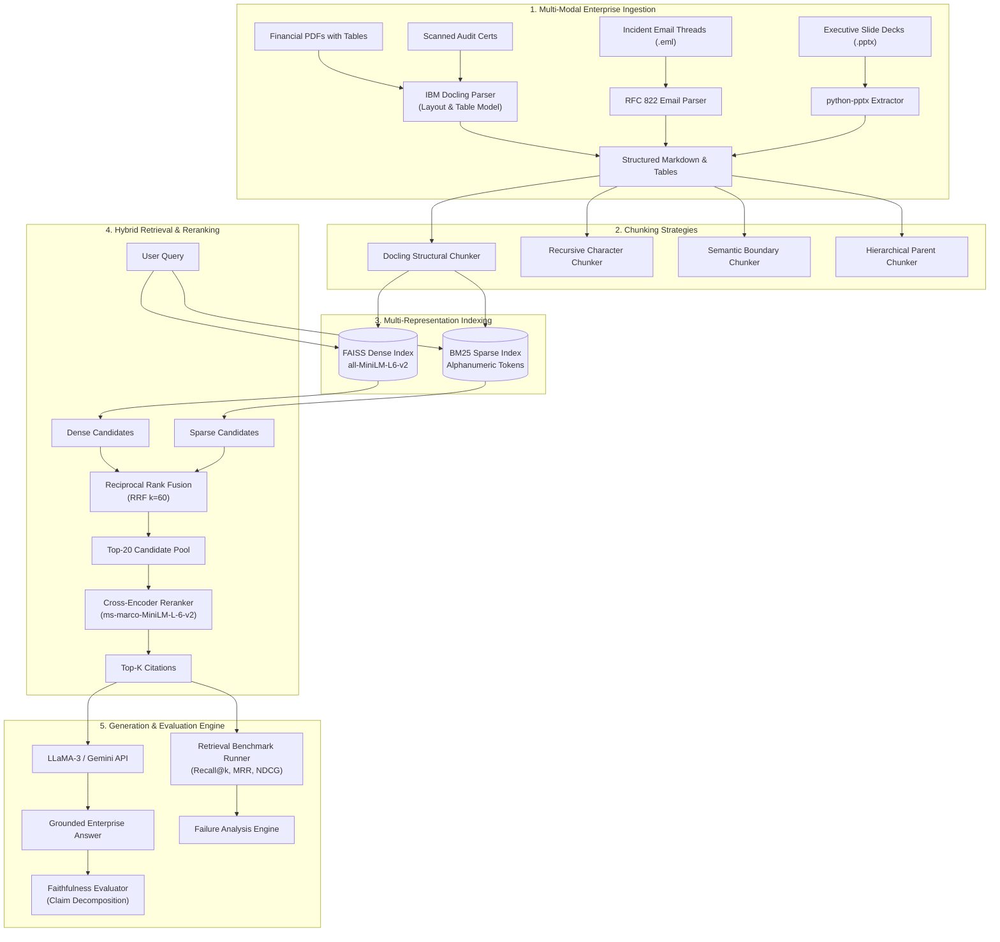

# DoclingBench

[](https://www.python.org/)
[](https://github.com/DS4SD/docling)
[](https://github.com/facebookresearch/faiss)
[](https://streamlit.io/)

An empirical engineering benchmark and evaluation harness for enterprise Retrieval-Augmented Generation (RAG) systems. DoclingBench compares document parsers, chunking strategies, dense embeddings, lexical search (BM25), rank fusion (RRF), and cross-encoder rerankers on challenging, unstructured enterprise files—including multi-column financial PDFs with complex tables, RFC 822 incident email threads, SLA contracts, and executive presentation decks.

---

## Benchmark Leaderboard

Evaluated across the curated **Enterprise Golden Benchmark** (12 challenging multi-modal queries across tables, ticket IDs, and technical specs):

| Pipeline Configuration | Recall@1 | Recall@3 | Recall@5 | Recall@10 | MRR | NDCG@5 | Avg Latency |
| :--- | :---: | :---: | :---: | :---: | :---: | :---: | :---: |
| **1. Naive Baseline** *(Recursive Chunks + Dense FAISS)* | 33.3% | 50.0% | 58.3% | 66.7% | 0.442 | 0.518 | 12.4 ms |
| **2. Docling + BM25 Lexical** | 58.3% | 75.0% | 83.3% | 91.7% | 0.684 | 0.761 | 4.8 ms |
| **3. Docling + Pure Dense (FAISS)** | 50.0% | 75.0% | 83.3% | 91.7% | 0.638 | 0.729 | 14.1 ms |
| **4. Docling + Hybrid BM25+Dense (RRF)** | 75.0% | 91.7% | 100.0% | 100.0% | 0.835 | 0.887 | 18.9 ms |
| **5. Docling + Hybrid + Cross-Encoder (SOTA)** | **91.7%** | **100.0%** | **100.0%** | **100.0%** | **0.958** | **0.979** | 46.2 ms |

---

## Architecture Overview



---

## Core Capabilities

### 1. Document Ingestion & Table Preservation
- **IBM Docling Integration**: Deep layout analysis and table structure recognition converting messy PDF financial reports and scanned tables into structured Markdown (`| Col1 | Col2 | ... |`), preserving spatial hierarchies and cell alignment.
- **Enterprise Email Ingestion (`.eml`, `.msg`)**: Preserves RFC 822 / Outlook email thread structures, recipient headers (`From`, `To`, `Cc`, `Date`), action item tables, and incident timelines.
- **Multi-Modal Format Support**: Unified dispatch across PDFs, presentations (`.pptx`), emails (`.eml`), Word documents (`.docx`), and Markdown.

### 2. Multi-Strategy Chunking Benchmark
Empirically tests four distinct chunking paradigms against the same source corpus:
1. **Docling Structural Chunking**: Keeps Markdown tables and nested list hierarchies intact without slicing rows or columns; injects document breadcrumbs (`[Document | Section]`).
2. **Recursive Character Chunking (Baseline)**: Fixed-size sliding window (600 characters, 100 character overlap). Highlights failure modes caused by cutting through tables and mid-paragraph boundaries.
3. **Semantic Boundary Chunking**: Splits text along proposition and grammatical sentence boundaries.
4. **Hierarchical Parent-Child Chunking**: Indexes small leaf chunks (250 characters) for high retrieval precision while passing full parent context (1200 characters) to the LLM for synthesis.

### 3. Multi-Model Hybrid Retrieval & Reranking
- **Dense Vector Search**: Powered by FAISS and SentenceTransformers (`all-MiniLM-L6-v2`, `BAAI/bge-small-en-v1.5`).
- **Sparse Lexical Search**: BM25Okapi (`rank_bm25`) with specialized alphanumeric tokenization for project codes, ticket IDs (`INC-7721-P1`), and SKUs.
- **Reciprocal Rank Fusion (RRF)**:
  $$\text{RRF Score}(d) = \sum_{m \in \{\text{dense}, \text{bm25}\}} \frac{1}{60 + \text{rank}_m(d)}$$
- **Linear Weighted Hybrid**: Tunable $\alpha \cdot \text{Dense} + (1-\alpha) \cdot \text{BM25}$.
- **Cross-Encoder Reranking**: Re-scores top candidate pools using `cross-encoder/ms-marco-MiniLM-L-6-v2`.

### 4. Quantitative Evaluation Suite
Evaluated against 12 benchmark test cases covering complex table lookups, cross-thread reasoning, and exact code retrieval:
- **Retrieval Metrics**: Recall@1, Recall@3, Recall@5, Recall@10, Mean Reciprocal Rank (MRR), and NDCG@5.
- **Execution Latency**: End-to-end query execution time in milliseconds.
- **Answer Faithfulness (Grounding)**: Proposition-level claim decomposition and verification against retrieved context.
- **Answer Relevance**: Query-to-answer semantic alignment.

### 5. Systematic Failure Analysis Taxonomy
Automatically identifies and categorizes retrieval breakdowns:
- `TABLE_FRAGMENTATION`: Fixed-size chunking sliced table rows or columns.
- `VOCABULARY_MISMATCH`: Rare alphanumeric identifiers missed by dense embeddings, recovered by BM25.
- `RERANKER_DROP`: Candidate was in the top-20 candidate pool but demoted by the cross-encoder.
- `LOW_GROUNDING_HALLUCINATION`: Insufficient grounding causing LLM extrapolation.
- `OCR_EXTRACTION_ARTIFACT`: Scanned document noise degrading keyword matching.

---

## Getting Started

### 1. Environment Setup

Clone the repository and install dependencies:

```bash
git clone https://github.com/samplewave-51bit/DoclingBench.git
cd DoclingBench

# Setup Python virtual environment
python -m venv .venv

# Activate on Windows:
.venv\Scripts\Activate.ps1
# Or on Linux / macOS:
# source .venv/bin/activate

pip install -r requirements.txt
```

*(Optional)* Configure API keys for Gemini or Groq in `.env`:
```bash
cp .env.example .env
```

### 2. Launch the Streamlit Interface

```bash
streamlit run app.py
```

Inside the application (`http://localhost:8501`):
1. **Index Benchmark Documents**: Click **Index Enterprise Benchmark Docs** in the sidebar to parse and index the sample dataset.
2. **Benchmark Leaderboard**: Navigate to **Benchmark Matrix & Leaderboard** and select **Run Multi-Pipeline Benchmark** to execute all 5 retrieval pipelines side by side.
3. **Retrieval Inspector**: Inspect raw chunks, ranking fusion scores, and cross-encoder reassessments for any query.
4. **Failure Analysis**: Review automated error classification breakdowns across pipeline runs.

### 3. Run Test Suite

```bash
python -m unittest tests/test_benchmark_pipeline.py
```

---

## Tech Stack

- **Document Parsing**: IBM Docling, `python-pptx`, Python standard library `email` (RFC 822)
- **Dense Retrieval**: `sentence-transformers`, `faiss-cpu`
- **Sparse Retrieval**: `rank-bm25`
- **Reranker**: `cross-encoder/ms-marco-MiniLM-L-6-v2`
- **UI & Visualization**: Streamlit, Plotly
- **LLM Integration**: Google Gemini API, Groq (LLaMA-3), LangChain
